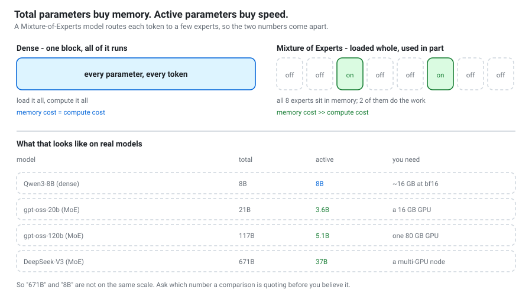
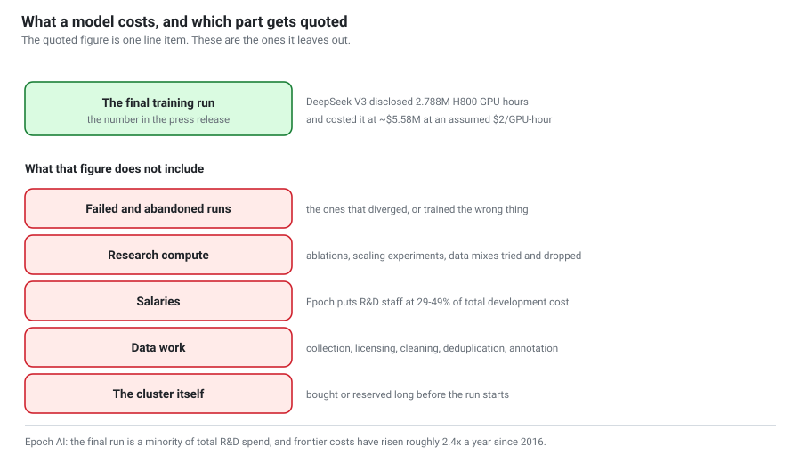
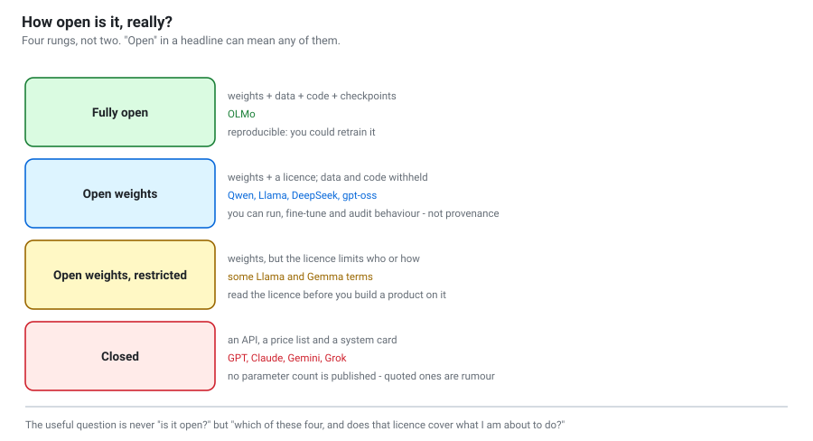

# Who builds these models, and what it costs
{: .no_toc }

Chapter 3 explained *how* a model is trained. Chapter 4 explained how to
*choose* one. This chapter is about the industry that makes them: how big the
models actually are, what the sizes mean, who can afford to build one, what it
costs, and — the part most write-ups skip — **how much of this is genuinely
known rather than repeated.**

1. TOC
{:toc}

---

{: .warning }
> **This chapter has a shelf life.** Model names and figures are a snapshot
> taken in **October 2026**, and this field moves faster than any document. The
> *structure* — what a parameter count means, where the money goes, what
> vendors do and do not disclose — will outlast the table of names. Where a
> number here disagrees with a primary source, believe the primary source.

## The question behind the question

People usually ask "how big is this model?" when they want the answer to one of
three quite different questions:

| You are really asking | The number that answers it |
|---|---|
| Will it run on my machine? | **Total** parameters × bits per parameter |
| How fast and cheap will it be? | **Active** parameters per token |
| Is it any good? | Neither. See [below](#size-is-the-weakest-predictor-of-quality). |

Conflating these is the single commonest mistake in model discussions, and
Mixture-of-Experts architectures made it much worse.

## Total parameters and active parameters

A **dense** model runs every parameter for every token. Qwen3-8B has 8 billion
parameters and uses all 8 billion to produce each token. Memory cost and
compute cost rise together.

A **Mixture of Experts (MoE)** model replaces the feed-forward block with many
parallel "experts" and a router that sends each token to only a few of them.
Every expert must sit in memory, but only the selected ones do arithmetic. The
two numbers come apart, and the naming convention reflects it:
`Qwen3-30B-A3B` means **30B total, 3B active**.

| Model | Total | Active | Architecture |
|---|---|---|---|
| Qwen3-8B | 8B | 8B | dense |
| gpt-oss-20b | 21B | 3.6B | MoE |
| gpt-oss-120b | 117B | 5.1B | MoE |
| DeepSeek-V3 | 671B | 37B | MoE |

Read that table twice. **DeepSeek-V3 has 84× the parameters of Qwen3-8B but
activates only about 4.6× as many per token.** It needs a server to hold, and
generates at a speed far closer to a mid-sized model than its headline number
suggests.

Three practical consequences:

1. **"671B vs 8B" is not a like-for-like comparison.** When a benchmark table
   puts those side by side, it is comparing a model you cannot run with one you
   can, on a number that predicts neither speed nor quality.
2. **MoE shifts your bottleneck from compute to memory.** This is why MoE
   models are attractive to API providers with big servers and frustrating for
   laptop users — you pay the full memory price for the speed of a small model.
3. **The active count is what you pay for per token.** It is the better
   predictor of latency and serving cost.

## Size is the weakest predictor of quality

Three things beat size, and the first two are why a genuinely good 4B model
exists at all.

**Training tokens.** [Chinchilla](https://arxiv.org/abs/2203.15556) found ~20
tokens per parameter was compute-optimal, and then the economics changed: a
model is trained once and served billions of times, so inference cost dominates
and it pays to train small models far past "optimal". Llama 3.1 saw around 15
trillion tokens across its sizes. A small model trained on vastly more data
beats an older larger one, routinely.

**Data quality.** Deduplication, filtering and curation move benchmark scores
more than a parameter-count increase of the same engineering effort. It is also
the least publicised part of any release, because it is the part that is
hardest to copy.

**Post-training.** The gap between a base model and the instruct model shipped
from the same weights is enormous — and it is, in compute terms, almost free.
DeepSeek-V3's own disclosure makes this vivid:

| Stage | H800 GPU-hours | Share |
|---|---|---|
| Pre-training | 2,664K | 95.6% |
| Context extension | 119K | 4.3% |
| Post-training | 5K | **0.2%** |
| **Total** | **2,788K** | |

**Post-training was two tenths of one percent of the compute and a large
fraction of what makes the model usable.** If you ever wonder why labs iterate
so fast on instruct versions while base models change slowly, that row is the
answer. It is also why your own fine-tuning (chapter 3, notebook 11) is
tractable on hardware you can rent.

## What it costs to build one

Two models have disclosed real numbers, and the contrast is the most
instructive thing in this chapter.

| | DeepSeek-V3 | Llama 3.1 405B |
|---|---|---|
| GPU-hours | 2.788M (H800) | 30.84M (H100-80GB) |
| Training tokens | 14.8T | ~15T |
| Parameters | 671B total / 37B active | 405B dense |
| Stated cost | ~$5.58M at an assumed $2/GPU-hour | not stated |

DeepSeek-V3 used roughly **a tenth** of Llama 3.1 405B's GPU-hours. That is a
real engineering result — MoE plus a great deal of low-level optimisation — and
it was widely reported as "a frontier model trained for $5 million."

**That reading is wrong, and the technical report says so itself.** The figure
covers the final training run only. It excludes:

* **failed and abandoned runs** — the ones that diverged or trained the wrong thing;
* **research compute** — ablations, scaling experiments, data mixes tried and dropped;
* **salaries** — [Epoch AI](https://epoch.ai/blog/how-much-does-it-cost-to-train-frontier-ai-models)
  puts R&D staff at **29–49%** of total development cost for GPT-4 and Gemini Ultra;
* **data work** — collection, licensing, cleaning, deduplication, annotation;
* **the cluster**, bought or reserved long before the run began.

Epoch's own framing is the one to remember: **the final training run is a
minority of total R&D spend.** A disclosed run cost is a floor, not a price tag.

### The trend

Epoch estimates the amortised hardware-and-energy cost of frontier final runs
has grown about **2.4× per year** since 2016 (95% CI 2.0–3.1×), and projects
runs above **$1 billion** around 2027. For GPT-4-era models they put the
breakdown at roughly **47–67% hardware, 29–49% R&D staff, 2–6% energy.**

The practical reading for a university: **training a frontier model is out of
reach and will get further out of reach.** Everything else in this workshop —
running open weights, fine-tuning with LoRA, building agents, evaluating them —
is not. That asymmetry is the reason open weights matter, and it is widening.

## How open is "open"?

"Open" in a headline can mean any of four quite different things.

| Rung | What you get | Examples | What you can do |
|---|---|---|---|
| **Fully open** | weights + data + code + checkpoints | OLMo | reproduce and retrain it |
| **Open weights** | weights + a licence | Qwen, Llama, DeepSeek, gpt-oss | run, fine-tune, audit *behaviour* |
| **Open weights, restricted** | weights, licence limits who or how | some Llama and Gemma terms | check the licence covers your use |
| **Closed** | an API, a price list, a system card | GPT, Claude, Gemini, Grok | measure it from the outside |

The useful question is never "is it open?" but **"which rung, and does that
licence cover what I am about to do?"** See
[the open-weight guide](../guides/open-weight-models.html) for the licence
detail.

{: .note }
> **Only the top rung is reproducible.** Open weights let you audit what a
> model *does*; they tell you nothing about what it was trained on. If you need
> provenance — for a regulated deployment, or a research claim about
> contamination — open weights are not enough, and OLMo-class releases are the
> only ones that answer the question.

### The line is blurring

In August 2025 OpenAI released **gpt-oss-120b and gpt-oss-20b** under Apache
2.0 — its first open-weight language models since GPT-2. The 120b fits on a
single 80 GB GPU and the 20b on a 16 GB one. A lab with a closed flagship now
also ships open weights; "open lab" and "closed lab" are no longer categories
that sort cleanly.

## Closed models: what is actually known

This is where most write-ups quietly start inventing, so it is worth being
precise.

**No major lab publishes parameter counts for its frontier closed models.** Not
OpenAI, not Anthropic, not Google, not xAI. Any specific figure you read for
GPT, Claude, Gemini or Grok is a rumour, a leak, or an inference from pricing
and latency. Some are well-reasoned. None are confirmed, and they are often
repeated until they acquire a false solidity.

What *is* knowable, and worth using instead:

| Knowable | Where from | How reliable |
|---|---|---|
| Price per input/output token | the vendor's pricing page | exact |
| Context window, rate limits | API documentation | exact |
| Latency and throughput | your own measurement | exact, for your workload |
| Safety evaluations, intended use | the model or system card | vendor-stated |
| Benchmark scores | vendor claims, third-party boards | contested; see below |
| Training compute | third-party estimates ([Epoch AI](https://epoch.ai/)) | an estimate, with stated uncertainty |

Epoch estimates closed-model compute indirectly — from hardware disclosures,
release timing, pricing and public statements — and publishes its uncertainty.
That is the right way to handle a number nobody will confirm: state the
estimate, state the method, state the error bars.

{: .warning }
> **Benchmark scores deserve particular suspicion**, and not only because
> vendors report their own. Benchmark data leaks into training sets; the
> *harness* that produces a score moves it as much as the model does. Notebook
> 20 measures exactly that — the same model's replies scoring 10%, 70% or 80%
> depending only on the scorer. A gap smaller than the harness spread is not a
> result.

## Why a closed model can be smaller than you think

A useful corrective to "closed models must be enormous": the economics push the
other way. A provider serving billions of tokens a day pays inference cost on
every one. Distillation, MoE routing, quantization and aggressive serving
optimisation all reduce the model actually answering your request. The flagship
you are billed for may be far smaller than its reputation — and the vendor has
no incentive to tell you either way.

This is why **"which model is bigger?" is rarely a question worth asking**, and
"which is cheaper per token on *my* task at *my* quality bar?" always is.

## A dated snapshot

{: .warning }
> **October 2026.** Expect this to be wrong within months. It is here for a
> sense of the field's shape, not for quoting. Verify every figure against the
> model card or the vendor's own documentation.

**Open-weight families worth knowing:** Qwen (Alibaba), Llama (Meta), DeepSeek,
Mistral, Gemma (Google), Phi (Microsoft), OLMo (AI2), gpt-oss (OpenAI), and a
growing set from Moonshot, MiniMax and others. The centre of gravity in
open-weight releases has moved decisively toward **large MoE models with small
active counts** — total parameters in the hundreds of billions to trillions,
active counts in the tens of billions.

**Closed flagships** are offered by OpenAI, Anthropic, Google and xAI, each
with a tiered lineup trading capability against price and latency, and each
revised often enough that naming any specific version here would be
counterproductive.

**For current facts, go to primary sources**, in this order:

1. **The model card** on Hugging Face or the vendor's site — parameter counts,
   licence, context length, recommended settings.
2. **The technical report.** Qwen, DeepSeek and OLMo publish substantial ones;
   an hour with a technical report beats a week of secondary coverage.
3. **[Epoch AI](https://epoch.ai/)** for training compute and cost estimates
   with stated methodology.
4. **Your own measurement** for anything about *your* task.

Aggregator sites and "best LLMs of 2026" listicles disagree with each other on
basic figures — parameter counts, active counts, release dates — often enough
that they should not be cited for any number you care about. While researching
this chapter, several contradicted each other on the same model's active
parameter count.

## What to take away

1. **Total ≠ active.** Ask which one a comparison quotes before believing it.
2. **Size predicts memory, not quality.** Tokens, data quality and
   post-training matter more, and post-training is nearly free in compute.
3. **A quoted training cost is the final run.** Epoch: that run is a minority
   of total R&D spend. Treat the figure as a floor.
4. **Openness is four rungs.** Only the top one gives provenance.
5. **Nobody publishes closed-model parameter counts.** Use price, latency,
   context and your own measurements instead of rumoured numbers.
6. **Check primary sources.** Model card, then technical report, then Epoch,
   then your own eval.

---

## Sources

The specific figures in this chapter, with where they come from:

* **DeepSeek-V3** — 671B total / 37B active, 14.8T tokens, 2.788M H800
  GPU-hours split 2,664K / 119K / 5K, costed at ~$5.576M at an assumed
  $2/GPU-hour: the [DeepSeek-V3 technical report](https://arxiv.org/abs/2412.19437)
  and the [model card](https://huggingface.co/deepseek-ai/DeepSeek-V3-Base).
* **Llama 3.1 405B** — 30.84M H100-80GB GPU-hours, ~15T tokens: the Llama 3.1
  model card.
* **gpt-oss** — 117B/5.1B and 21B/3.6B, Apache 2.0, August 2025:
  [OpenAI's release](https://openai.com/index/introducing-gpt-oss/).
* **Cost trends and breakdowns** — 2.4×/year growth (95% CI 2.0–3.1×), the
  47–67% / 29–49% / 2–6% split, the final run as a minority of R&D spend, and
  the $1B projection: [Epoch AI](https://epoch.ai/blog/how-much-does-it-cost-to-train-frontier-ai-models).
* **Chinchilla** — ~20 tokens per parameter: [Hoffmann et al., 2022](https://arxiv.org/abs/2203.15556).

Every figure above is either disclosed by the organisation that trained the
model or an estimate published with its methodology. Nothing in this chapter is
a rumoured parameter count, and where a number is unknown this chapter says so
rather than guessing.
